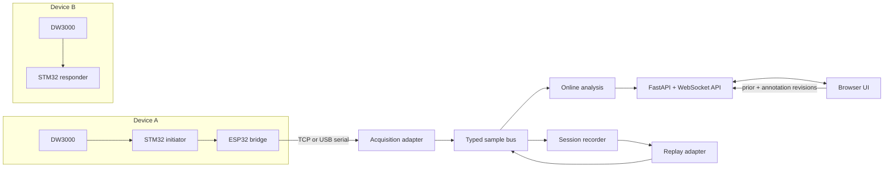

# Target Architecture and Data Contract

Status: proposed baseline. Record material changes here before implementation.

## Design principles

1. Preserve raw observations and attach derived interpretations separately.
2. Use one domain model for live, replayed, and batch data.
3. Keep the radio loop independent from UI latency and model computation.
4. Give every sample, prior, annotation, and configuration a stable identity.
5. Prefer explicit quality flags and missing values over silent substitution.

## Target system



The host should be a Python package with clear modules rather than analysis embedded in UI callbacks:

```text
host/uwb_lab/
├── acquisition/      TCP, serial, and replay adapters
├── protocol/         Wire decoding, validation, and schema versions
├── domain/           Samples, priors, annotations, sessions
├── analysis/         Online residuals, filters, windows, quality metrics
├── storage/          Atomic recording and manifest handling
├── api/              HTTP/WebSocket endpoints
└── ui/               Browser assets and plots
```

Recommended first implementation: FastAPI, Pydantic, pandas/NumPy/SciPy, PyArrow Parquet, SQLite for session metadata, and Plotly in a small browser UI. Keep the UI thin; analysis functions must also run in tests and notebooks without a browser.

## UI layout

The first useful screen should be an experiment console, not a landing page.

### Persistent status bar

- Device/transport state and last-sample age.
- Session name and recording state.
- Valid/invalid sample rate, dropped sequence count, and current firmware/schema versions.

### Live measurement view

- Raw and corrected range versus device monotonic time.
- Expected range and uncertainty band from the active prior.
- Residual, rolling mean, rolling standard deviation, and robust outlier score.
- Current values with units and explicit stale/invalid state.
- Optional radio-quality channels as they become available.

### Geometry and prior controls

Support two input modes:

1. Node A and node B positions `(x, y, z)` in metres.
2. Direct expected separation in metres.

Required fields:

- Coordinate frame/name.
- Position or distance uncertainty.
- Effective time: now or a selected sample/time.
- Operator note and optional source/instrument.

Saving creates a new immutable `prior_revision`; it does not rewrite previous samples. The online analyzer applies the revision immediately to subsequent samples and can recompute a selected historical interval on request.

For positions `p_a` and `p_b`, expected distance is `||p_a - p_b||`. The residual convention is always:

```text
residual_m = observed_range_m - expected_range_m
```

### Experiment controls

- Start/stop recording with required scenario metadata.
- Add timestamped markers such as `occlusion_start`, `occlusion_end`, `motion_start`, and free-form notes.
- Set a provisional LOS/NLOS/unknown label for an interval.
- Download/export a closed session and its manifest.

## Device wire protocol

### Transitional adapter

The first host parser may extract `ds_twr.distance` and `ds_twr.corrected` from current logs so UI work can begin. This parser is explicitly transitional and must retain unparsed source lines for diagnosis.

### Stable protocol

Use UTF-8 newline-delimited JSON (NDJSON) at the host boundary. At expected research rates this is well within 115200-baud capacity, easy to record, and easy to inspect. Each line is one complete message. Unknown fields are ignored; unknown major schema versions are rejected.

Minimum range message:

```json
{"schema_version":"1.0","type":"range","device_id":"uwb-01","boot_id":"8f31c2a4","sequence":1842,"device_time_us":91234001,"exchange_id":921,"peer_id":"uwb-02","raw_range_m":2.438,"corrected_range_m":2.421,"valid":true,"quality_flags":[]}
```

Desired diagnostics when supported by the DW3000 driver:

```json
{"rx_power_dbm":-71.2,"first_path_power_dbm":-74.8,"first_path_index":745.5,"cir_power":123456,"noise_std":18,"sts_quality":0.82,"clock_offset_ppm":-1.7,"temperature_c":31.4,"voltage_v":3.28}
```

Do not invent unavailable diagnostic values. Omit them or use `null`, and record a capability message after boot.

Other message types:

- `hello`: firmware, protocol, board role, radio configuration, capabilities.
- `health`: counters, queue occupancy, resets, UART/TCP drops, radio errors.
- `event`: boot, clock reset, radio reset, configuration applied, fatal error.
- `ack`: result of a host command when bidirectional control is added.

Every range sample requires:

- `schema_version`, `type`, `device_id`, and random-per-boot `boot_id`.
- Monotonic `sequence`, `device_time_us`, and exchange identity.
- Peer identity, raw range, validity, and machine-readable quality flags.

The host adds `host_receive_time_utc`, `session_id`, and transport metadata. It must not overwrite the device timestamp.

## Host domain records

### Prior revision

```json
{
  "prior_id":"prior-0042",
  "session_id":"session-20260928-01",
  "effective_from_sequence":1843,
  "mode":"positions_3d",
  "frame_id":"lab-a",
  "node_a_m":[0.0,0.0,0.42],
  "node_b_m":[2.4,0.0,0.42],
  "expected_distance_m":2.4,
  "distance_std_m":0.005,
  "source":"laser_meter",
  "note":"clear LOS"
}
```

The host resolves active priors by sequence/device time, not by browser arrival order. A direct-distance prior uses `mode: "distance"` and omits node coordinates.

### Derived sample

Derived values reference, rather than mutate, the raw sample:

```json
{"sample_id":"8f31c2a4:1842","prior_id":"prior-0041","pipeline_version":"online-0.1.0","expected_distance_m":2.4,"residual_m":0.038,"rolling_bias_m":0.031,"rolling_std_m":0.012}
```

## Storage

Use a session directory that can be written atomically and replayed without a database server:

```text
session-20260928-01/
├── manifest.json
├── telemetry.ndjson       lossless received device messages
├── samples.parquet        validated typed samples
├── priors.ndjson          immutable prior revisions
├── annotations.ndjson     event markers and interval labels
└── checksums.sha256
```

SQLite may index sessions and serve the UI, but the portable session directory is the archival unit. Closing a session writes checksums and marks the manifest complete.

## Control path

Dynamic analysis priors belong on the host and do not require a command to the radio. Device commands are reserved for operational settings such as sample rate or radio configuration.

When implemented, commands must be allow-listed, validated, acknowledged, and recorded in the session. The ESP32 must forward TCP-to-UART data and use framed messages; the STM32 must parse commands outside interrupt context. No host command may block or directly mutate an in-progress ranging exchange.

## Safety and security

- Move Wi-Fi credentials out of tracked C source.
- Bind the first host service to localhost by default.
- Treat the ESP32 TCP link as trusted-lab-only until authentication or an isolated network is provided.
- Apply message length limits and numeric range checks at every input boundary.
- Never execute free-form strings received from a device or UI.
