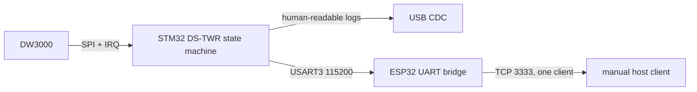

# Current Codebase Layout

Status: verified against the workspace on 2026-09-28.

## Overview

```text
UWB/
├── epuck-stm32-main/        STM32F405 firmware and DW3000/Qorvo integration
├── epuck-esp32-main/        ESP-IDF UART-to-TCP bridge
├── docs/                    Project context and integration design
└── uwb.code-workspace       VS Code workspace definition
```

There is currently no host application, persistent dataset schema, automated end-to-end test, or live UI in the repository.

## STM32 firmware

### Entry point and peripherals

[`epuck-stm32-main/Core/Src/main.c`](../epuck-stm32-main/Core/Src/main.c) is STM32CubeMX-generated application code with project logic in `USER CODE` regions.

Current behavior:

- Initializes GPIO, ADC1, I2C1, SPI1, USART1, USART3, and USB CDC.
- Initializes a Qorvo link and repeatedly calls `qorvo_link_process()` from the main loop.
- Toggles a status LED at 1 Hz.
- Selects board identity and TX/RX role with compile-time macros. The checked-in selection is board 2, responder/RX; the initiator selection is commented out.
- Redirects `printf` to USB CDC through `_write()`. Qorvo platform logging also uses USART3, which is the path consumed by the ESP32 bridge.

USART3 and the ESP32 bridge both use 115200 baud. SPI1 starts with a conservative clock prescaler for DW3000 initialization.

### Qorvo/DW3000 integration

[`epuck-stm32-main/ThirdParty/qorvo_dw3/platform/qorvo_port.c`](../epuck-stm32-main/ThirdParty/qorvo_dw3/platform/qorvo_port.c) owns the high-level radio configuration, DS-TWR state machine, timestamp exchange, range calculation, calibration statistics, and human-readable logs.

[`epuck-stm32-main/ThirdParty/qorvo_dw3/platform/qorvo_platform.h`](../epuck-stm32-main/ThirdParty/qorvo_dw3/platform/qorvo_platform.h) exposes the public link and platform API. Supporting files provide SPI, IRQ, and sleep callbacks for the vendor driver.

Current link behavior:

- Uses an interrupt-driven POLL/ANSWER/FINAL/REPORT exchange.
- The initiator starts an exchange every 1000 ms.
- The initiator calculates raw and corrected DS-TWR distance after a matching REPORT.
- Results are emitted as multi-line diagnostic text such as `ds_twr.distance` and `ds_twr.corrected`.
- A compile-time antenna-delay calibration mode can collect statistics at one hard-coded known distance.
- A range-bias hook exists but is disabled and currently returns the unmodified range.
- Range diagnostics suitable for NLOS analysis are not yet part of a stable telemetry record.

[`epuck-stm32-main/Core/Src/dwm3000_port.c`](../epuck-stm32-main/Core/Src/dwm3000_port.c) is an earlier/basic SPI device-ID test path. It is compiled, but `main.c` currently uses the higher-level Qorvo platform API.

### USB CDC

[`epuck-stm32-main/USB_DEVICE/App/usbd_cdc_if.c`](../epuck-stm32-main/USB_DEVICE/App/usbd_cdc_if.c) supplies the generated virtual COM port interface.

- Transmit is implemented and used for logs.
- Receive only re-arms the USB endpoint; it does not parse or dispatch commands.
- `CDC_Transmit_FS()` can return busy. Current logging does not provide a queued, loss-aware telemetry channel.

### Build and flash

[`epuck-stm32-main/CMakeLists.txt`](../epuck-stm32-main/CMakeLists.txt) builds CubeMX sources, the project platform layer, and the Qorvo driver. Floating-point `printf` support is enabled.

From `epuck-stm32-main/`:

```bash
bash scripts/stm32_build.sh Debug
bash scripts/stm32_flash.sh Debug
```

The flash script uses ST-Link and OpenOCD. The role currently requires a source edit and a separate firmware build for each board; build-time CMake options or board-specific presets are planned.

## ESP32 firmware

[`epuck-esp32-main/main/main.c`](../epuck-esp32-main/main/main.c) is an ESP-IDF application with two FreeRTOS tasks.

Current behavior:

- Connects as a Wi-Fi station using credentials compiled into the source.
- Reads UART1 on GPIO 43/44 at 115200 baud.
- Exposes a single-client TCP server on port 3333.
- Forwards UART bytes to the connected TCP client and blinks an activity LED.
- Reads TCP input only to detect disconnects; received bytes are discarded and are not forwarded to the STM32.
- Logs UART content as text, so arbitrary or future binary frames are not currently safe.

The project uses standard ESP-IDF CMake files. Wi-Fi credentials must move to ignored local configuration, menuconfig/NVS provisioning, or another non-source mechanism before broader use.

## Current end-to-end data path



Important limitations:

- Output is debug text, not a versioned measurement protocol.
- There is no sample-level host timestamp, session identity, prior revision, or durable recording.
- There is no complete command path from TCP/USB to the ranging application.
- Board role and network credentials are compile-time source values.
- The bridge has no authentication, discovery, encryption, buffering contract, or multi-client support.
- One-second ranging does not yet exercise the temporal resolution required by the research objective.

## Ownership boundary to preserve

- **STM32:** radio timing, ranging exchange, hardware diagnostics, monotonic sample identity.
- **ESP32:** optional transport bridge and network provisioning, not scientific correction logic.
- **Host:** recording, priors, derived values, visualization, annotations, statistical models, and reproducibility metadata.
