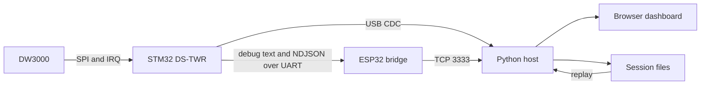

# Implementation Summary

This document separates the firmware that existed before the first integration pass from the features added during that pass.

## Original STM32 firmware

The STM32 application already provided the core ranging implementation:

- STM32F405 startup and peripheral initialization generated by STM32CubeMX.
- SPI communication with the DW3000, GPIO reset/chip-select control, and interrupt handling.
- An interrupt-driven double-sided two-way ranging exchange using `POLL`, `ANSWER`, `FINAL`, and `REPORT` frames.
- Distance calculation on the initiator from six DW3000 timestamps.
- Optional compile-time antenna-delay calibration statistics and an inactive range-bias hook.
- Human-readable diagnostics sent through USB CDC and USART3.
- A status LED toggled from the main loop.
- Board ID and TX/RX role selected by manually editing macros in `main.c`.

The application loop initialized the Qorvo link, repeatedly called `qorvo_link_process()`, and otherwise only maintained the status LED. It did not provide a stable machine-readable telemetry record or receive host commands.

## Original ESP32 firmware

The ESP32 application was a simple FreeRTOS network bridge:

- Connected to one hard-coded Wi-Fi network as a station.
- Read STM32 output from UART1 at 115200 baud on GPIO 43/44.
- Hosted a one-client TCP server on port 3333.
- Forwarded UART data to the connected TCP client.
- Read TCP data only to detect disconnects; incoming data was discarded.
- Blinked GPIO 46 when UART data arrived.

This made STM32 logs remotely visible, but provided no configurable credentials, structured data contract, recording, analysis, or UI.

## Current implementation

### STM32 changes

- Added `TxDebug` and `RxDebug` CMake presets, removing the need to edit source when changing board role.
- Added one compact NDJSON record after each successful initiator range calculation:

```json
{"type":"range","v":1,"board":1,"peer":2,"seq":42,"time_ms":12000,"raw_m":2.0140,"corrected_m":2.0140,"valid":true}
```

- Preserved the existing readable debug output and DS-TWR implementation.

### ESP32 changes

- Moved Wi-Fi SSID, password, and TCP port to ESP-IDF `menuconfig` options.
- Added TCP-to-UART forwarding, making the bridge bidirectional at the byte level.
- Added ESP32 setup instructions and selected the ESP32-S3 build target.
- Installed ESP-IDF v5.5.5 locally and verified that the firmware builds successfully.

The STM32 still does not parse application commands, so the reverse path is available but not yet used by the UI.

### Host application

A small Python/FastAPI application was added under `host/`:

- Demo source for development without hardware.
- ESP32 TCP, direct USB serial, and recorded-file replay sources.
- Validation of the compact version-1 range messages while ignoring debug lines.
- Browser dashboard with live distance and residual plots.
- Rolling residual bias and standard deviation.
- Direct-distance or 3D node-position priors that apply immediately.
- Immutable prior revision numbers attached to derived samples.
- Start/stop recording to NDJSON with a small JSON manifest.
- Replay of recorded sessions through the same live pipeline.
- Stream counters for samples, malformed lines, and missing sequence numbers.
- Five focused tests for parsing, prior validation, residual calculation, and recording.

### Supporting work

- Added project context, architecture, integration, experiment, literature, and status documents under `docs/`.
- Added ignored storage under `data/sessions/` for local recordings.
- Added a project Python virtual environment and declared dependencies in `host/pyproject.toml`.
- Installed a user-local `idf.py` launcher at `~/.local/bin/idf.py`.
- Added an idempotent macOS bootstrap, environment checker, firmware builder, dashboard runner, and top-level `make` commands.

## Current data flow



## Verified

- STM32 `TxDebug` and `RxDebug` builds complete successfully.
- ESP32-S3 firmware builds with ESP-IDF v5.5.5.
- Host test suite passes.
- Demo streaming, prior updates, recording, and replay work in the browser.
- The dashboard fits a 390-pixel mobile viewport without horizontal overflow.

## Still to do

- Flash and test the complete STM32/ESP32 chain on the physical boards.
- Enter local Wi-Fi credentials with `idf.py menuconfig`.
- Calibrate antenna delays and collect controlled LOS/NLOS datasets.
- Add experiment event labels and DW3000 quality diagnostics.
- Add a small offline analysis script, followed by simple LOS/NLOS baselines.

For the actively maintained checklist, see [IMPLEMENTATION_STATUS.md](IMPLEMENTATION_STATUS.md).